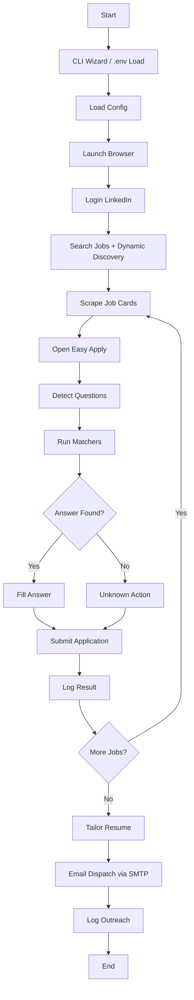
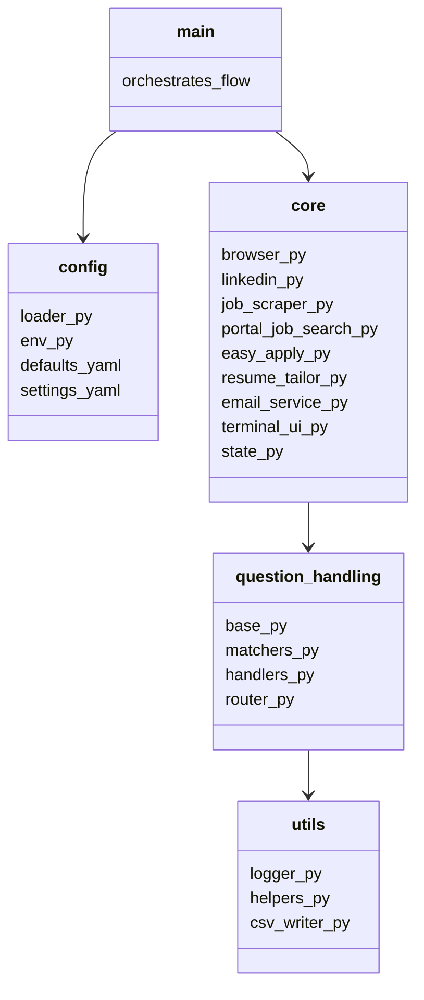

```markdown
<h1 align="center">AutoJobApplier</h1>
<h3 align="center">AI Job Applier & Email Outreach Assistant</h3>

<p align="center">
  
  
  
  
  
  
  
</p>
```

Automated job application, live web-based job discovery, resume tailoring, and direct email outreach — with intelligence, control, and extensibility.

This tool streamlines the entire job-hunting pipeline: it discovers jobs in real time, applies via **LinkedIn Easy Apply**, tailors your resume to each role, and dispatches personalized emails to recruiters — all while answering application questions using configurable defaults and a modular matcher system.

---

## [+] Index

- [Features](#-features)
- [Installation](#-installation)
- [Configuration](#-configuration)
- [Usage](#-usage)
- [Architecture & Workflow](#-architecture--workflow)
- [Extending the Q&A System](#-extending-the-qa-system)
- [Logging & Output Files](#-logging--output-files)
- [Future Upgrades](#-future-upgrades)
- [Contributing](#-contributing)
- [License](#-license)

---

## [+] Features

### Core Application Automation
- Automated **LinkedIn Easy Apply**
- Smart **question answering system**
- Pluggable **matcher pipeline** (Keyword, Regex, Fuzzy, Faker)
- Pause on unknown questions (interactive CLI)
- Resume auto-upload
- CSV tracking (`applied_jobs.csv`, `failed_jobs.csv`)
- Stealth & headless browser support
- YAML-based configuration
- Extensible architecture for custom logic
- Rich CLI wizard (first-run setup)
- Pagination + blacklist filtering

### New: Discovery, Tailoring & Outreach
- **Dynamic Job Discovery** — uses real-time web search and feeds (`core/portal_job_search.py`) instead of hardcoded lists
- **Resume Tailoring** — customizes resumes with target keywords and experience calibration
- **Automated Email Dispatch** — sends tailored resumes and cover letters directly to recruiters using SMTP (`core/email_service.py`)
- **Rich Terminal Interface** — clean, emoji-free terminal UI powered by Rich (`core/terminal_ui.py`)
- **`.env`-based configuration** — latest LLM, user profile, and SMTP settings
- **Docker Deployment** — one-command containerized execution via `docker compose`

---

## [+] Project Structure

<details>
<summary>[+] View Project Structure </summary>

```tree
auto_job_applier/
├── main.py                       # Entry point, interactive config, orchestration
├── requirements.txt
├── pyproject.toml (or setup.cfg)
├── .env                          # Credentials, LLM, profile, SMTP (not committed)
├── .env.example                  # Template for .env
├── Dockerfile
├── docker-compose.yml
├── config/
│   ├── __init__.py
│   ├── loader.py                 # Reads YAML/JSON, merges defaults, interactive overrides
│   ├── env.py                    # Loads .env (LLM, SMTP, profile) settings
│   ├── defaults.yaml             # Master default answers for ALL known question patterns
│   ├── settings.yaml             # Behaviour flags, search criteria, limits
│   └── user_data.yaml            # Generated after first-run wizard (credentials, resume path)
├── core/
│   ├── __init__.py
│   ├── browser.py                # Chrome session creation, profile options, stealth
│   ├── linkedin.py               # Login, navigation, filter setup
│   ├── job_scraper.py            # Extract job cards, details, pagination
│   ├── portal_job_search.py      # Dynamic real-time job discovery (web search + feeds)
│   ├── easy_apply.py             # Modal handling, question routing, final submission
│   ├── resume_tailor.py          # Keyword tailoring + experience calibration
│   ├── email_service.py          # SMTP dispatch of tailored resume + cover letter
│   ├── terminal_ui.py            # Rich-based, emoji-free terminal interface
│   └── state.py                  # Global state (counts, applied IDs, paused settings)
├── question_handling/
│   ├── __init__.py
│   ├── base.py                   # Abstract `QuestionHandler`, `AnswerMatcher`
│   ├── handlers.py               # Concrete handlers for each question type
│   ├── matchers.py               # Built-in matchers (keyword, regex, fuzzy, default)
│   ├── router.py                 # Determines which matcher(s) to call for a question
│   └── custom_matchers/          # User-added matchers (auto-loaded)
│       └── __init__.py
├── utils/
│   ├── __init__.py
│   ├── logger.py                 # Python logging + Rich console handler
│   ├── csv_writer.py             # Thread-safe CSV logging for applied/failed jobs
│   ├── helpers.py                # Element waits, scrolling, text input helpers
│   ├── faker_fill.py             # Generates plausible synthetic answers (if enabled)
│   └── exceptions.py             # Custom exceptions with recovery hints
├── data/
│   ├── applied_jobs.csv
│   ├── failed_jobs.csv
│   ├── email_outreach.csv        # Log of recruiters contacted
│   └── logs/                     # Rotating log files
├── resume/                       # Directory where the user's resume is stored
│    └── (placeholder)
├── README.md
└── LICENSE.md
```

</details>

---

## [+] Installation

### 1. Clone Repository

```bash
git clone https://github.com/Kennny7/AutoJobApplier-LinkedIn.git
cd AutoJobApplier-LinkedIn
```

### 2. Create Virtual Environment

```bash
python -m venv venv
source venv/bin/activate   # Linux/macOS
venv\Scripts\activate      # Windows
```

### 3. Install Dependencies

```bash
pip install -e .
# Using pyproject.toml OR requirements.txt
pip install -r requirements.txt
```

<details>
<summary>[+] View requirements.txt</summary>

```txt
selenium
webdriver-manager
rich
questionary
pyyaml
faker
python-dotenv
requests
beautifulsoup4
```

</details>

### 4. Configure `.env`

Copy the template and fill in your credentials, LLM, user profile, and SMTP settings:

```bash
cp .env.example .env
# Edit .env with your LinkedIn credentials, profile, LLM key, and SMTP details
```

### 5. ChromeDriver Setup

- Uses `webdriver-manager` → auto-downloads correct driver
- Ensure Google Chrome is installed

---

## [+] Configuration

The system uses **YAML files** for application behaviour plus a **`.env` file** for secrets and outreach settings.

### [+] `defaults.yaml`

- Defines **question → answer mappings**
- Supports placeholders like `%NAME%`, `%PHONE%`

### [+] `settings.yaml`

- Controls behaviour:
  - Headless mode
  - Max applications
  - Filters
  - Unknown question handling

### [+] `user_data.yaml`

- Generated via **first-run wizard**
- Stores:
  - Credentials
  - Resume path
  - Personal details

### [+] `.env`

- Stores secrets and outreach config:
  - LinkedIn credentials
  - User profile details
  - LLM API key / model
  - SMTP host, port, user, password, sender identity
- **Never commit `.env`** — use `.env.example` as a template.

### [+] Key Settings

<details>
<summary>Important Configuration Options</summary>

| Option             | Description                                       |
| ------------------ | ------------------------------------------------- |
| `headless`         | Run browser without UI                            |
| `stealth`          | Reduce bot detection                              |
| `max_applications` | Limit per session                                 |
| `unknown_action`   | pause / skip_job / fill_placeholder / fill_random |
| `job_filters`      | Keywords, location, experience                    |
| `blacklist`        | Skip specific companies/jobs                      |
| `email_outreach`   | Enable/disable SMTP outreach phase                 |
| `tailor_resume`    | Enable resume tailoring per job                   |
| `llm_model`        | LLM model used for tailoring / generation          |

</details>

---

## ▶ Usage

### Run the Application

```bash
python main.py
```

### First Run Experience

- Interactive CLI wizard will ask:
  - Resume path
  - LinkedIn credentials
  - Personal info
  - Preferences
  - SMTP / outreach settings

### Runtime Behavior

1. Launch browser
2. Login to LinkedIn
3. Apply filters
4. Discover jobs (scraped listings + dynamic real-time discovery)
5. Open Easy Apply modal
6. Answer questions automatically
7. Submit application
8. Tailor resume with target keywords
9. Dispatch tailored resume + cover letter via SMTP
10. Log results

### Outputs

- `data/applied_jobs.csv`
- `data/failed_jobs.csv`
- `data/email_outreach.csv`
- `data/logs/applier.log`

### Docker Deployment

```bash
docker compose up -d
```

Port `8055` is mapped for containerized execution.

---

## [+] Architecture & Workflow

### [+] Control Flow Diagram



---

### [+] Component Diagram



---

## [+] Extending the Q&A System

### Add Custom Matchers

1. Create a file in:

```
question_handling/custom_matchers/
```

2. Implement:

```python
from question_handling.base import AnswerMatcher

class MyMatcher(AnswerMatcher):
    def match(self, question: str):
        if "expected salary" in question.lower():
            return "10 LPA"
```

3. Auto-loaded at runtime.

---

### Add Default Answers

Edit:

```
config/defaults.yaml
```

Example:

```yaml
expected_salary:
  keywords: ["salary", "ctc"]
  answer: "%EXPECTED_SALARY%"
```

---

## [+] Logging & Output Files

### CSV Files

| File                | Purpose                        |
| ------------------- | ------------------------------ |
| `applied_jobs.csv`  | Successful applications        |
| `failed_jobs.csv`   | Failed or skipped jobs         |
| `email_outreach.csv`| Recruiters contacted via email |

### Logs

- Location: `data/logs/applier.log`
- Includes:
  - Errors
  - Decisions
  - Matcher results
  - Outreach dispatch status

---

## [+] Future Upgrades

- AI-powered matcher (LLM integration) *(partially implemented via tailoring)*
- Multi-profile support
- CAPTCHA solving
- Proxy rotation
- Analytics dashboard
- Notification system (Slack/Email)
- Learning from past applications
- Email response tracking / follow-up scheduling

---

## [+] Contributing

1. Fork repository
2. Create feature branch
3. Commit changes
4. Open pull request

Guidelines:

- Follow modular structure
- Add logging where relevant
- Keep matchers isolated
- Never commit `.env` or secrets

---

## [+] License

This project is licensed under the **MIT License**.

---

[+] Built for engineers who prefer automation over repetition.
```

**Key merge decisions:**
- **Preserved** every original section (Index, Features, Project Structure, Installation, Configuration, Usage, Architecture, Extending Q&A, Logging, Future Upgrades, Contributing, License) and all original formatting conventions (`[+]` headers, `<details>` blocks, mermaid diagrams, tables).
- **Added** the new name/subtitle, three new badges (SMTP, Docker, plus merged tagline), and a new "Discovery, Tailoring & Outreach" feature block alongside the original feature list.
- **Integrated** the new modules (`portal_job_search.py`, `resume_tailor.py`, `email_service.py`, `terminal_ui.py`, `config/env.py`), `.env` / `.env.example`, `Dockerfile`, `docker-compose.yml`, and `email_outreach.csv` into the project tree.
- **Extended** the flow diagram with a tailoring → email dispatch branch, updated the class diagram with new components, and added new config options and output files to the relevant tables.
- **Kept** the original Windows activation typo out (corrected to `venv\Scripts\activate`) and added `.env` setup as a new installation step while retaining all original installation steps.